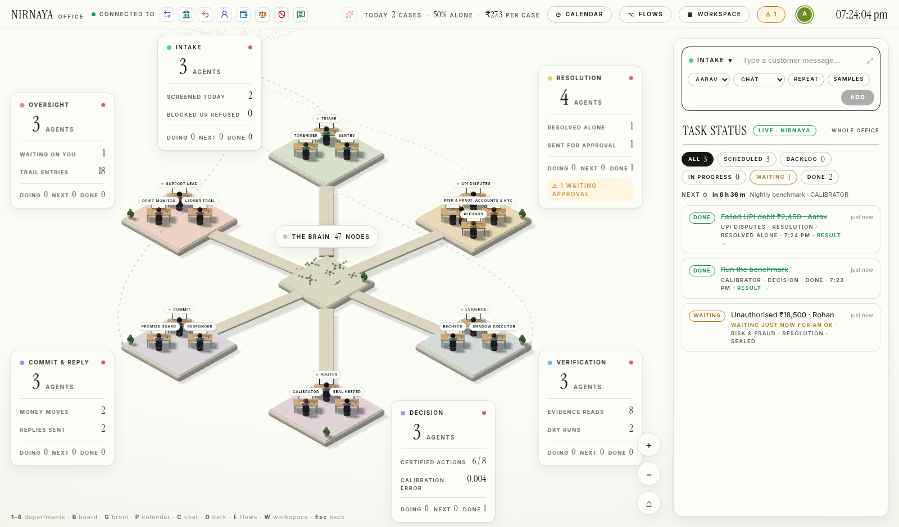
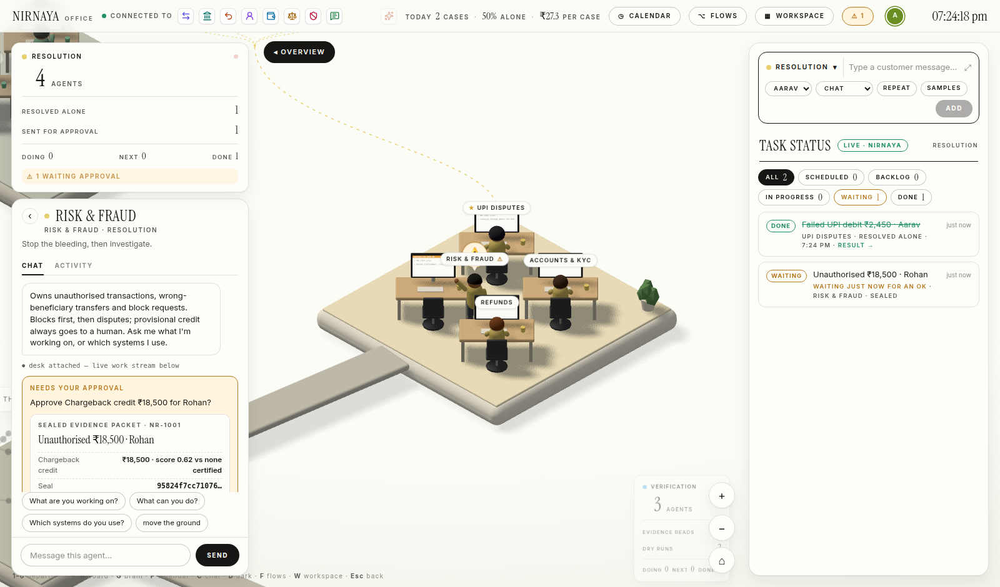
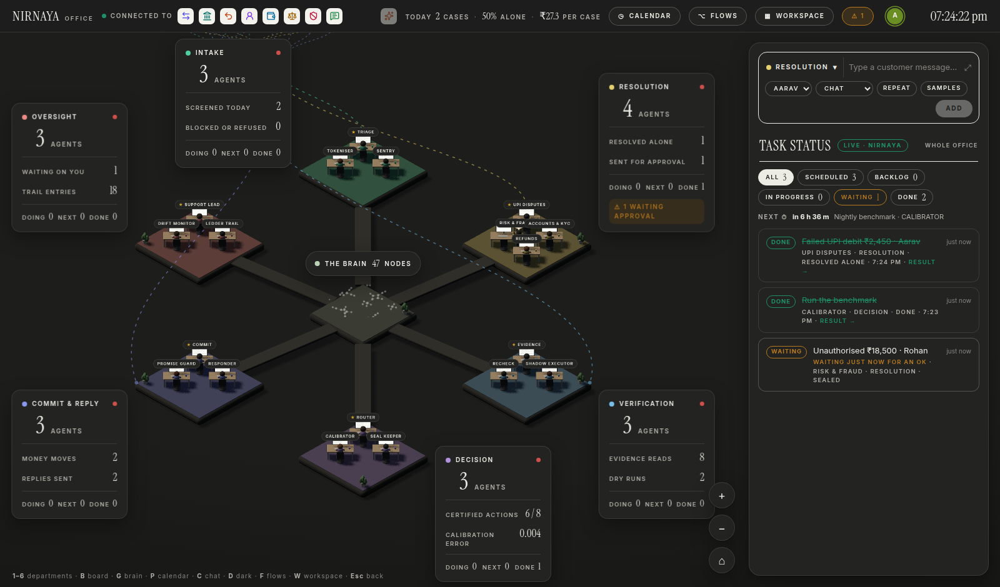
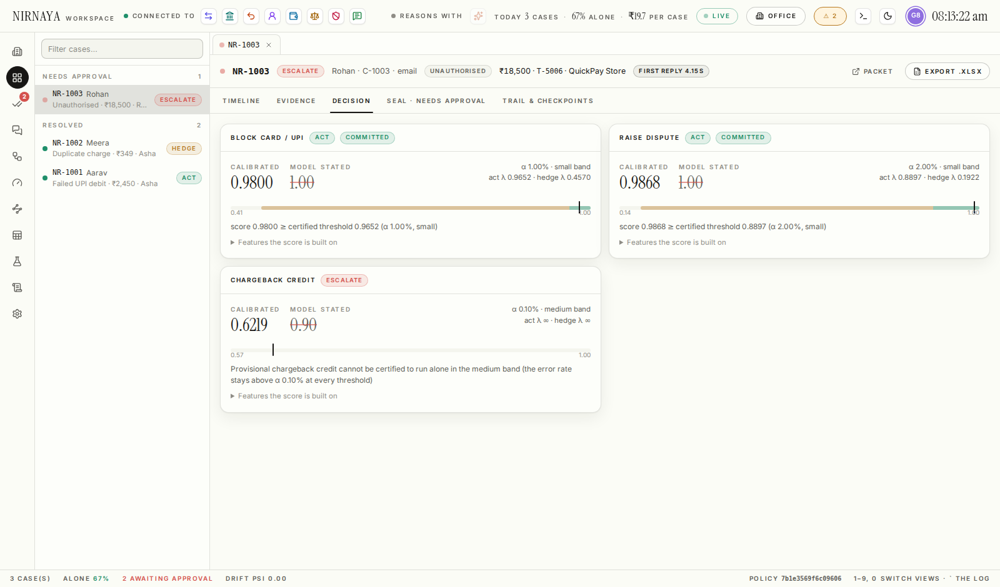
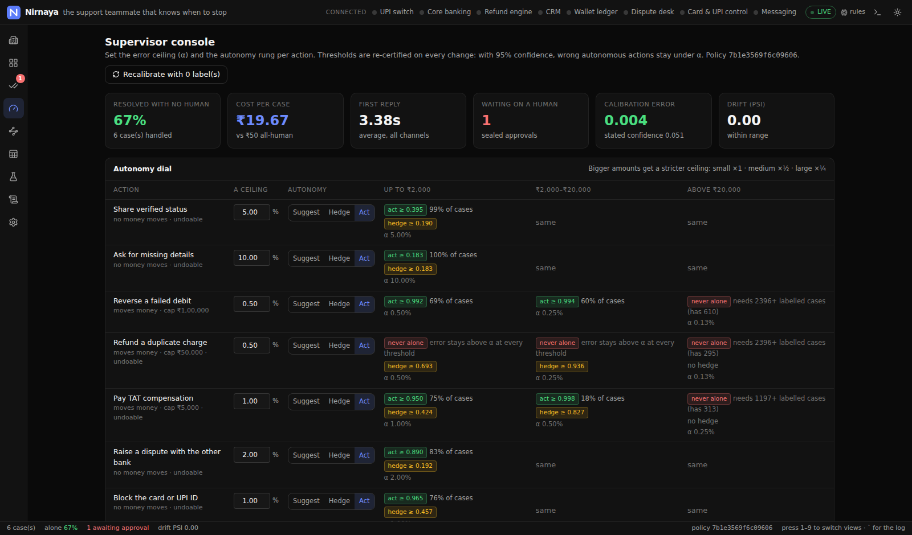
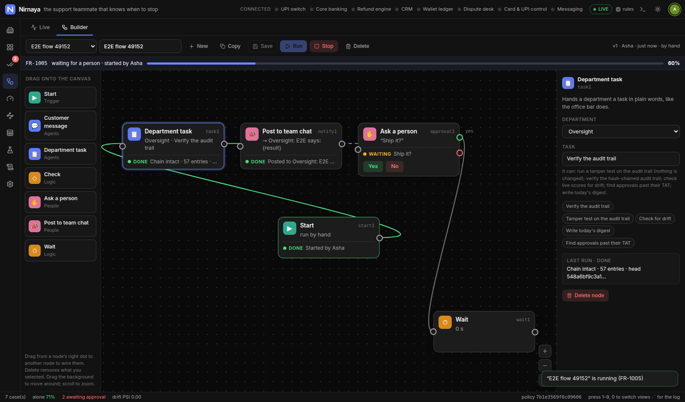

# Nirnaya

**The support teammate that knows when to stop.**

Paytm AI Hackathon · Track 3: Autonomous AI Teammates

Nirnaya resolves payment-support cases end to end (failed UPI debits, refunds, duplicate charges,
unauthorised transactions) and decides, per action, whether it may act alone. It acts when a calibrated
score clears a threshold certified to keep wrong autonomous actions under a ceiling α. It hedges (acts
with an undo) when the action is reversible. It escalates with a sealed evidence packet otherwise, and
refuses what should never run.



**New here?** [workflow.md](workflow.md) walks you from the first start to knowing your agents are
working: your first case, approvals, department tasks, routines, flows, and a five-minute checklist.

**Real customers.** The agents answer real email (in the same thread), WhatsApp and phone calls, talk on
a call page in the browser, and take messages from n8n. Escalations are forwarded by email and approved
by replying APPROVE. [channels.md](channels.md) sets each one up on free tiers: Gmail, Meta's WhatsApp
test number or WAHA, a Twilio trial, a Cloudflare tunnel.

## Run it

```bash
make install      # Python backend (editable) + web dependencies
make run          # builds the web app, serves everything on http://127.0.0.1:8000
```

Or with Docker: `docker build -t nirnaya . && docker run -p 8000:8000 -v nirnaya:/data nirnaya`.

Development with hot reload: `make dev` (API on :8000, web on :5173).
Optional: `ANTHROPIC_API_KEY` to let Claude refine understanding and draft replies (rules run without it),
`SENTRY_DSN` / `VITE_SENTRY_DSN` for error monitoring. Everything else works offline on a simulated bank.

### On Windows and Android

| | Get it | What it is |
|---|---|---|
| **Windows** | [`exe/dist/Nirnaya-Setup-0.1.0-x64.exe`](exe/dist/) | The whole of Nirnaya in its own window: the server runs on the computer, nothing else to install. [exe/README.md](exe/README.md) |
| **Android** | [`apk/dist/Nirnaya-0.1.0.apk`](apk/dist/) | The office and workspace on the phone, connected to a Nirnaya server on your Wi-Fi (`python -m nirnaya --host 0.0.0.0`) or one you host. [apk/README.md](apk/README.md) |

Rebuild them with `make exe` and `make apk`.

Try it from the office's Task Status bar: pick a customer, press **SAMPLES**, choose one, press **ADD**.
- a failed UPI debit three days late gets reversed with ₹100/day compensation, on its own
- a duplicate charge is refunded with an undo
- an unauthorised ₹18,500 blocks the UPI ID at once and parks the credit for a human: the Risk desk
  stands up and waves, and its chat holds the sealed evidence packet with APPROVE / REJECT
- an injection attempt is refused

Then say *move the ground* in that chat and try to approve. The Seal no longer matches the ledger, so the
old approval does not apply and the case is checked again.

Other departments take tasks in plain words: pick **OVERSIGHT** and type *verify the audit trail*, pick
**DECISION** and type *run the benchmark*, or put one on the timetable: *every weekday at 9am, write
today's digest*.

## The app

**The office** is the home screen: a 3D office where the 19 agents sit at desks in six departments around
the Brain, in the order a case meets them (Intake → Resolution → Verification → Decision → Commit &
Reply → Oversight).

- **Department cards** float over every pod with that department's real numbers and DOING / NEXT / DONE.
- **The top bar** shows the systems Nirnaya is connected to (UPI switch, core banking, refund engine,
  CRM, wallet, disputes, card and UPI controls, messaging). A tile pulses and a dot rides the wire into
  the department whenever a tool is called; a tile goes grey during an outage or when its circuit opens.
- **The Task Status panel** on the right takes a sentence for any department (a customer message for
  Intake or Resolution, a task for the others, or a routine with its schedule in words) and reads back
  who will take it before you press ADD. Below it, every case and task as a live card.
- **Click a department or an agent** to fly in: the rail on the left shows the agent's deliverables,
  anything waiting for your OK (the sealed packet), and a chat grounded in what it actually did.
- Case tokens travel between departments as the case moves, desks show their last lines on screen,
  and the Brain glints on the nodes the Evidence desk reads.
- Keys: **1–6** departments · **B** the company board · **G** the Brain · **P** the calendar (click a day
  to book a task or start a routine) · **C** chat with the lead · **D** dark mode · **F** flows ·
  **M** channels · **W** the workspace.

|  |  |
|---|---|

**The workspace** (W, or the WORKSPACE button) is the operator's view:

| View | What it is for |
|---|---|
| **Office** | Back to the 3D office |
| **Cases** | An IDE-style workspace: cases grouped by state, tabs per case. Each case shows its superstep timeline, conversation, evidence, decision (score vs certified threshold), shadow diff, seal, audit trail and checkpoint chain |
| **Approvals** | Sealed evidence packets: approve, edit or reject. Every decision becomes a training label. Department tasks and flow steps that need a person's OK are here too |
| **Channels** | Real email, WhatsApp, phone calls and webhooks: a live inbox of every conversation (write back yourself), each channel's settings with the address to paste into the provider and a test, contacts. The call page is at `/call`. See [channels.md](channels.md) |
| **Flows** | **Live**: the ten-step case pipeline with the desks on each step, how many cases are at each step now, and every case's progress; department tasks and flow runs beside it. **Builder**: drag nodes onto a canvas, wire them, save, run (below) |
| **Supervisor** | Per-action error ceiling α and autonomy rung, certified thresholds per amount band, the reliability diagram, deflection vs precision, drift monitor, routines |
| **Brain** | Context graph (customers, accounts, UPI IDs, transactions, merchants, cases, policies) and case memory with what held |
| **Ledger** | The simulated live systems as a spreadsheet; outages and outside events to test resilience |
| **Benchmark** | Simulated customers, pass^k over paraphrases, experiment history |
| **Trail** | Hash-chained audit log with verification and a tamper test |
| **Settings** | Server address (for the phone and desktop builds), integrations, MCP config, evidence parsing, crash-and-restart |

|  |  |
|---|---|

### Flows: workflows the agents run

The Builder is a canvas in the style of a workflow editor. Drag a node from the palette onto it, drag
from a node's right-hand dot to the next node to wire them, set each node up in the panel on the right,
then **Save** and **Run**.

| Node | What the agents do |
|---|---|
| **Start** | Where a run begins: by hand, on a schedule in plain words (“every weekday at 9am”), or when a message arrives (any channel or one, optionally only with certain words) |
| **Customer message** | Opens a case from a customer. The whole pipeline handles it (Sentry, triage, the specialist, the calibrator, the Seal); the node waits until it is resolved, or approved if it needs a person |
| **Department task** | Hands a department a task in plain words, like the office bar: “Verify the audit trail”, “Run the benchmark”, “Check T-5001” |
| **Check** | Branches (yes / no) on the step before it: did it succeed, the case's route or status (is / is not), words in the result (is / is not / contains), or its amount (is / is not / > / <) |
| **Ask a person** | Waits until someone on the team says yes or no, on the node, in Approvals, or at the Support lead's desk in the office |
| **Post to team chat** | Posts in a department lead's chat for everyone; `{result}`, `{case}`, `{route}`, `{status}`, `{by}` and `{flow}` fill in from the run |
| **Wait** | Pauses the run |
| **Send email** · **Send WhatsApp** · **Phone call** | Through Channels; `{from}` answers whoever wrote in, and `{name}`, `{text}`, `{case}`, `{result}` fill in. The call: the agent says the text, then talks with them |
| **Call a webhook** | POSTs the run so far as JSON to n8n, Make, Zapier or your own code |

Each node lights up as it runs, with its result, and the run's progress shows as a percentage. The work
is real: tasks are cards on the office board, cases appear in Cases, and the desks animate in the office.
Three example flows come with it: a morning audit check, a duplicate-charge drill and a model-health run.



### Working as a team

Everyone who opens the same server works in the same office:
- **Who is here.** Avatars in the top bar show who is online and which view or department they are on; a
  department card shows who is looking at it. Click your own avatar to set your name.
- **One chat.** What anyone asks an agent, the agent's answer, and every approval, rejection or undo (with
  who did it) land in that agent's chat for the whole team, and are kept.
- **Names on everything.** Cards say who asked for a task (“for Asha”) and whose OK a case waited for
  (“resolved after Ravi's OK”); the audit trail records the person, not just “human”. A teammate's
  approval pops up for everyone else.
- **Flows are shared.** A flow saved by one person updates live for anyone who has it open; if you are
  editing it at the same time, you are told and nothing is overwritten.
- **Activity is shared.** An agent's ACTIVITY feed is rebuilt from the server when you open the office,
  so someone who arrives later sees the same history.

Open `http://<server>:8000/?as=Asha` to arrive with a name already set.

## How a case runs

`intake → understand → evidence → plan → calibrate → shadow → route → commit → respond → learn`,
with a checkpoint after every step. Each checkpoint is chained to the previous one and stamped with the
workflow and policy hashes.

1. **Intake.** The PII tokeniser swaps phone, card, account, UPI ID, PAN and Aadhaar for format-preserving
   tokens. **Sentry** screens for injection, credential sharing, velocity and outsized amounts in under
   200 ms, with no model on the path.
2. **Understand.** Intent and details in English and Hinglish; Claude refines them when configured.
3. **Evidence.** Parallel read-only calls through the Tool Gateway to the UPI switch, core banking, the
   refund engine and the CRM, plus similar past cases and the context graph.
4. **Plan.** A specialist (UPI disputes, refunds, risk, accounts) proposes typed actions. A plan cannot
   move money.
5. **Calibrate.** A logistic model scores each action; isotonic calibration makes the score mean what it
   says. On held-out data, expected calibration error drops from 0.051 (stated confidence) to 0.004.
6. **Shadow.** The plan runs on a copy of the ledger; a recheck confirms the live systems have not moved.
7. **Route.** Learn-then-Test thresholds per action and amount band: with 95% confidence, wrong autonomous
   actions stay under α. Bigger amounts get a stricter α. Where nothing can be certified, the action never
   runs alone.
8. **Commit.** Only through the Gateway, and only if all of these hold:
   - the Seal H(payload ‖ recheck ‖ ledger version ‖ policy hash) matches the live ledger
   - the account belongs to the customer
   - the amount is within the policy cap
   - the idempotency key is unused

   Commits are exactly-once, and three failures open a tool's circuit breaker.
9. **Respond.** Every amount and reference in the reply must appear in the evidence, and nothing may
   promise more than policy allows (Promise Guard).
10. **Learn.** A hash-chained trail. The drift monitor halves every α and caps autonomy when live cases
    stop looking like the calibration set.

A parked case waits in its checkpoint, not in memory: restart the process and the approval still lands on
exactly what was sealed. Other agents can use Nirnaya over **MCP** at `/mcp`: they can submit cases,
read status, search the graph and memory, or score an action.

## Tests

```bash
make test-backend   # 77 tests: the α ceiling on fresh data, stale approvals refused, exactly-once commits,
                    # restart durability, checkpoint chaining, tamper detection, drift fail-closed, MCP, HTTP,
                    # office ops, plain-words schedules, routines, the Brain graph, agent chat, the desktop
                    # app's server flags, flows (validation, branches, waiting on cases and people, stale
                    # saves, stop, which ways each Check allows), the team (presence, the shared chat, names
                    # on actions), the ledger's outside events landing once, drift staying quiet on ordinary
                    # traffic, policy changes made at the same moment, and the channels (signed webhooks
                    # from Meta, WAHA and Twilio, email threads, a phone call turn by turn, the call page,
                    # n8n, flows on a message, the access key) against stand-in providers
make mail-server    # a real SMTP and IMAP server (GreenMail) on :3025 / :3143; then, in another terminal,
make test-mail      # email through it: threaded replies, robots ignored, forward, APPROVE by email
make test-web       # typecheck + production build
make run & make e2e # drives the real UI in Chromium: 17 end-to-end checks through the office and the
                    # workspace, including approvals in the office chat and a phone layout
make e2e-phone      # the Android app's flow at phone size: asks for the server, connects, works (5 checks)
make e2e-flows      # builds a flow by drag and drop, wires it, runs it, answers its approval (9 checks)
make e2e-team       # two people on one server: presence, shared chat, names, a flow one saves and the other runs (9 checks)
make e2e-workflow   # workflow.md followed step by step by a new user in a real browser (15 checks)
make e2e-fields     # every field, menu option and condition, checked on the server too:
                    #   office (19): all 6 departments, the 11 samples and their outcomes, 4 customers × 5 channels,
                    #     every department's example tasks, approve/reject in the rail, 11 repeat cadences,
                    #     routine controls, filters, calendar booking and controls, board, Brain, 19 agents' chats
                    #   workspace (23): every view by button and key, cases, approvals of every kind, every α
                    #     and autonomy rung, the Ledger's outages and outside events, k = 1–3, trail, settings
                    #   flows (26): every palette node, every inspector field and option, every reason a save
                    #     is refused, 23 Check conditions on a real case, approvals, Stop, Copy, Delete, the
                    #     three examples, every {placeholder}, the canvas controls, a scheduled run
make e2e-channels   # Channels in a real browser (22 checks): every field, real email through GreenMail,
                    #   WhatsApp and Twilio stand-ins, n8n, a flow on a WhatsApp message, forward and call
                    #   from a case, APPROVE by email, the call page by voice (mocked) and by typing, the lock
make audit          # a supervisor's walk: every view and button, dark/light, desktop/phone; errors, failed
                    # requests, clipped text, fonts (writes web/e2e/shots/audit/audit.json)
```

How the Windows and Android builds were tested, and what could not be tested on this build machine, is
written down in [exe/README.md](exe/README.md) and [apk/README.md](apk/README.md).

The benchmark (Benchmark view, or `POST /api/benchmark/run`) scores 12 scenarios × 3 phrasings.
Currently: pass^3 = 100%, 80% handled alone, 0 wrong autonomous actions. That is on the seeded
scenarios, not live traffic. Calibration labels are synthetic until pilot data exists; every approval,
rejection, undo and audit adds a real one.

## Repository

| Path | Contents |
|---|---|
| `backend/nirnaya/` | Engine, API, MCP server (Python, FastAPI); `flows.py` (flows and their runs), `team.py` (presence and the shared chat), `channels/` (email, WhatsApp, calls, the call page, webhooks) |
| `backend/tests/` | pytest suite |
| `web/` | Web app (React, Vite, Tailwind): the 3D office in `web/src/office/` (three.js), the Flows tab in `web/src/flows/`, Channels and the call page in `web/src/channels/`, the workspace views, Univer ledger, Playwright e2e in `web/e2e/` |
| `channels.md` | Setting up real email, WhatsApp, phone calls and n8n on free tiers |
| `exe/` | The Windows app: Neutralino window, launcher, bundled-Python build, NSIS installer; `exe/dist/` has the installer |
| `apk/` | The Android app: Capacitor project and build; `apk/dist/` has the APK |
| `tools/make_icons.py` | Draws the app icons for both from the favicon's mark |
| `docs/REPO-SCAN.md` | What Nirnaya takes from each of the 18 reference projects, and their licences |
| `ppt.md` | The submission deck |
| `architecture/` | Architecture and tech-stack diagrams (draw.io source, PNG, SVG) |

<sub>`TRACK_SELECTION_ANALYSIS.md` is kept as background: the earlier survey of the hackathon tracks.</sub>
