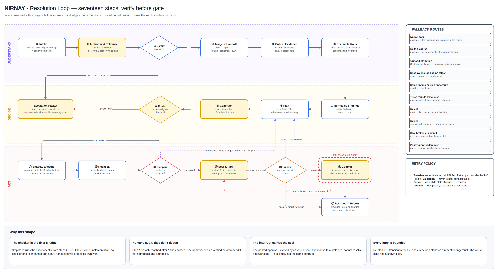
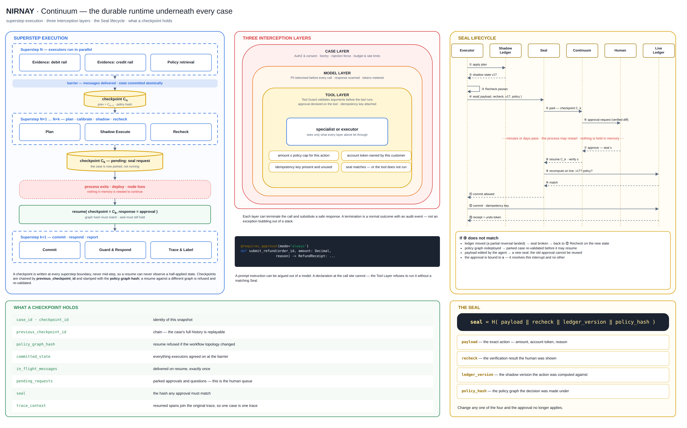
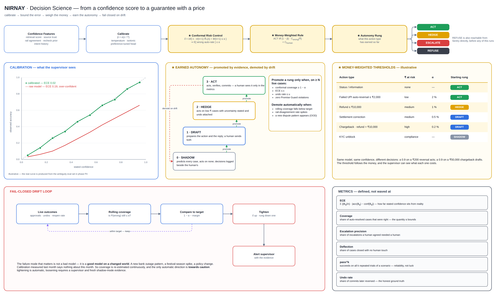
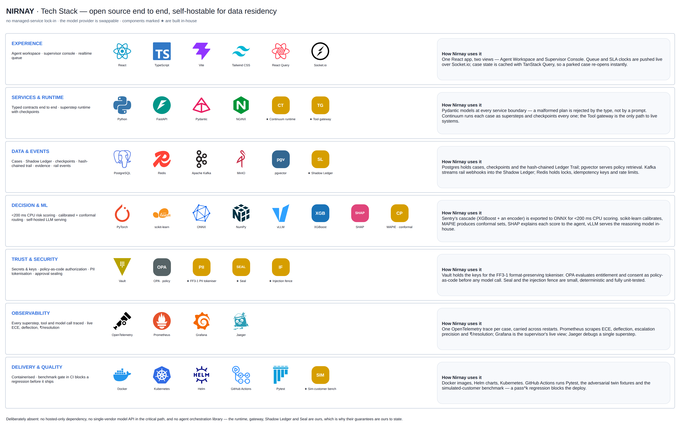
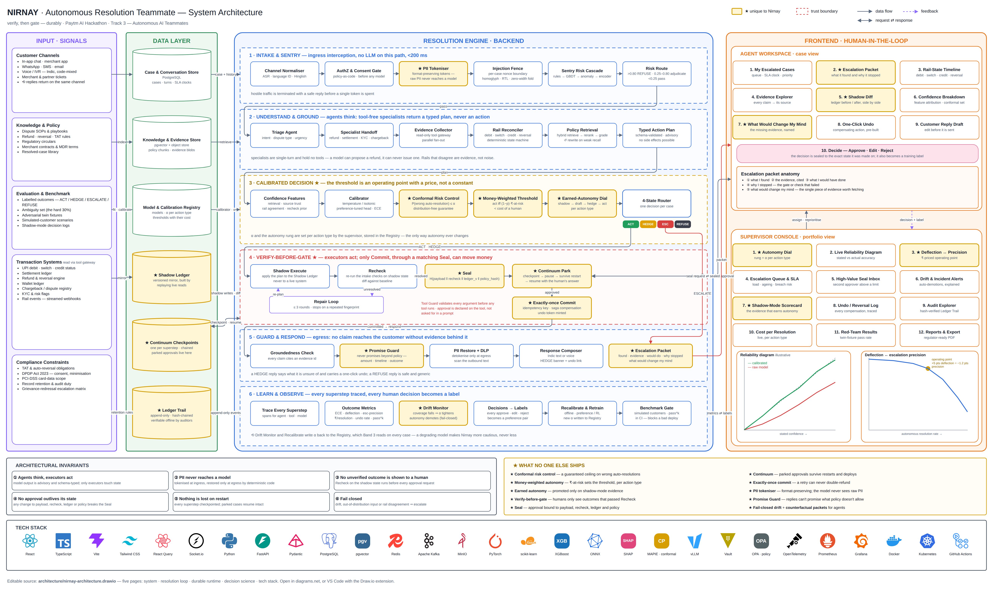

# Nirnay

### The support teammate that verifies before it acts — and knows when to stop

**Paytm AI Hackathon · Track 3 — Autonomous AI Teammates**

**Karthik Janardhan** · [@karthikj30](https://github.com/karthikj30) · karthikjanardhan5@gmail.com
25 September 2026

---
---

# 1 · Problem Statement

### Support automation is stuck at ~30%. The model is not the bottleneck.

- A payments platform's disputes — stuck UPI transfers, failed settlements, chargebacks, KYC blocks — split roughly **30% automated / 70% human**.
- The 70% is not there because the agent *can't* resolve it. It's there because **nobody can bound the cost of being wrong**, so "escalate" is the safe default.

### The real defect: confidence nobody has measured

Every production support agent draws its boundary the same way:

```python
if amount > 5000 or sentiment == "angry" or confidence < 0.7:
    escalate()
```

Three numbers chosen in a meeting. Not wrong — **unmeasurable**. Nobody can answer:

- When the agent says 80% sure, **is it right 80% of the time?**
- What did the last threshold change cost, in wrongly-escalated tickets?
- Which of those three conditions is actually carrying the decision?

### Three failures that follow

| Failure | What it looks like |
|---|---|
| **Overconfidence** | Published research shows a model's stated confidence is systematically higher than its accuracy. An agent that says "I'm sure" and is wrong a third of the time is worse than one that stays silent — you've built process around believing it. |
| **Act-then-hope** | Agents execute and report success without ever re-checking the system they touched. Nobody catches the half-applied refund. |
| **Approval theatre** | "Human-in-the-loop" usually means a pop-up approving a *step*. The state moves underneath it, the process restarts, the queue is lost. |

> **The brief asks for "escalating to humans only when needed."**
> Nobody can currently define *needed*. That is the problem worth solving.

---
---

# 2 · Proposed Solution

## 2.1 · The idea in one screen

**Nirnay is a customer-resolution teammate built on two rules nobody else applies together:**

> **① Never ask a human to approve an unverified outcome.**
> **② Never let an approval outlive the state it was given for.**

### Four decisions, not two

| Decision | Trigger | Behaviour |
|---|---|---|
| 🟢 **ACT** | calibrated confidence ≥ high | Executes, verifies, logs, notifies, records the outcome |
| 🟡 **HEDGE** | mid band | Acts, **states its uncertainty in the reply**, attaches one-click undo |
| 🔴 **ESCALATE** | below threshold | Hands a **structured packet** to a human — findings, evidence, the action it *would* have taken, why it stopped |
| ⛔ **REFUSE** | adversarial / policy-violating | Blocked before the model runs, in <200 ms, written to the audit trail |

**The middle two rows are the product.** Everyone ships row 1 and row 3.

---

## 2.2 · Seven components, built from scratch

| Component | Job |
|---|---|
| **Sentry** | Ingress guard. Scores every message for risk with small local models — no LLM in the path, <200 ms. Terminates hostile traffic before a token is spent. |
| **Router** | The four-state decision. Consumes a *calibrated* confidence score, not a raw model probability. |
| **Shadow Ledger** | A write-capable mirror of the live systems. Every proposed action lands here first. Nothing touches production un-verified. |
| **Recheck** | Re-runs the **same deterministic checks that intake ran**, against the shadow state, and diffs the result against the baseline. |
| **Seal** | The approval gate. Binds a human's decision to a content hash, not to a workflow step. |
| **Continuum** | Durable pause/resume. Writes a checkpoint when a case blocks on a human; the case survives restarts, deploys and crashes. |
| **Ledger Trail** | Append-only, hash-chained audit. Every decision, refusal, approval and reversal, with its inputs — verifiable offline. |

Four supporting guards sit around them: **Tool Gateway** (the only path to live systems), **PII Tokeniser** (the model never sees raw PII), **Promise Guard** (a reply can't promise what policy doesn't allow) and **Drift Monitor** (fails closed). All eleven are shown across the architecture diagrams in §3.2.

---

## 2.3 · The mechanism: act in a shadow, verify, *then* gate

Most agents: **decide → act → report.**
Nirnay: **decide → act in the Shadow Ledger → Recheck → compare to baseline → gate on the verified delta.**

```
 propose  ──▶  Shadow Ledger  ──▶  RECHECK  ──▶  compare vs baseline
                (never live)      (same code         │
                                   as intake)        ├─ resolved & confident ──▶ Seal ──▶ commit
                                                     ├─ resolved, mid band   ──▶ commit + undo token
                                                     ├─ no change / worse    ──▶ retry (bounded, max 3)
                                                     └─ still unresolved     ──▶ escalate with evidence
```

- The code that *verifies* the fix is the code that *found* the problem. **Drift between checker and fixer is structurally impossible** — there is only one implementation.
- **Bounded retry**, not infinite. Three attempts, then a human — with all three attempts attached.
- A human is only ever shown **a result that already passed verification**.



- Every fallback is an explicit edge, not an exception: rails disagree → escalate · same fingerprint → stop · rejected → report only · seal broken at commit → re-request.
- The parked approval is keyed by **case id + seal**, so a response to a stale state can't resolve a newer one — it isn't the same interrupt.

---

## 2.4 · Approvals that survive a restart

Money-moving tools are declared as requiring approval **in the tool definition, not in a prompt**:

```python
@requires_approval(mode="always")
def submit_refund(order_id: str, amount: Decimal, reason: str) -> RefundReceipt: ...
```

- A prompt instruction can be argued out of the model. **A declaration at the call site cannot.**
- When it fires, **Continuum** writes a checkpoint and the case parks. The process may exit, deploy, crash, restart.
- It resumes from the checkpoint with the human's response attached — the pending case is still there, intact.

**Seal** binds the approval to four things at once:

```
seal = H( payload ‖ recheck ‖ ledger_version ‖ policy_hash )
```

- **payload** — the exact action · **recheck** — the verification the human was shown · **ledger_version** — the shadow state it was computed on · **policy_hash** — the policy graph it was decided under
- Change any one of the four before commit and **the seal breaks; approval is re-requested.**
- A redeploy mid-case is covered too: a parked case re-validates against the new policy graph before it may resume.

> **You approve *this exact action, in this exact state* — not "the refund step".**
> That distinction is the whole difference between a demo and a system that touches money.



- Cases execute as **supersteps**: state commits atomically at each barrier and a checkpoint is written there — never mid-step, so a resume can't observe a half-applied state.
- Checkpoints are **chained** and stamped with the policy graph hash; the parked approval lives inside the checkpoint, not in memory.
- Three interception layers — **case, model, tool** — each can end a call with a safe response and an audit event, instead of an exception.

---

## 2.5 · Three locks before anything leaves the sandbox

Capability is off by default at three independent levels, none of which is the model's judgement:

1. **Deployment policy** — money-moving tools are disabled unless the environment enables them
2. **Case opt-in** — the individual case must additionally request the capability
3. **Sealed approval** — bound to the verified artifact, as above

Plus deterministic primitives that **never ask a model a safety question**: tool allow-lists, protected-field sets, PII redaction on every log line, and structural fencing of retrieved policy text inside a per-case nonce boundary.

---

## 2.6 · How it addresses the problem

| Problem | Mechanism | Result |
|---|---|---|
| Escalation boundary is a guess | Confidence post-trained for **calibration**, reported as Expected Calibration Error | The threshold becomes a **defensible operating point**, not an opinion |
| Nobody knows the cost of moving it | Deflection-rate vs escalation-precision curve from the eval set | You can **price** a threshold change before shipping it |
| Agents act and hope | Shadow Ledger + Recheck with the intake code | **Wrong actions are caught before a human ever sees them** |
| Approvals go stale | Sealed, checkpointed, resumable approval | Approval **cannot drift** onto a different action |
| Only two outcomes exist | HEDGE band with undo | Cases escalated "just in case" **get resolved** |
| Nothing is measurable | Simulated-customer benchmark, scored across repeated trials | Outcomes are **reported, not asserted** |

**The mechanism of the business result:** calibration does not make the agent smarter. It makes the threshold **movable**. Every point of autonomy above 30% is a point nobody could previously justify buying.

---

## 2.7 · Innovation & Uniqueness

### Ten things that, together, nobody in this field ships

| # | What | Why it matters |
|:-:|---|---|
| **1** | **Calibrated four-state escalation** — ACT · HEDGE · ESCALATE · REFUSE on a *trained* confidence, reported as ECE, benchmarked with pass^k | Production support agents hardcode the boundary. **None reports a calibration metric.** |
| **2** | **Conformal risk control** — P(wrong auto-resolution) ≤ α, distribution-free | Calibration says "80% means 80%". Conformal turns that into a **bound you can write into an SLA**. |
| **3** | **Money-weighted autonomy** — act only if (1 − p) · ₹-at-risk < cost of a human; α set per action type | Same confidence, different decisions: 0.9 on a ₹200 reversal **acts**; 0.9 on a ₹50,000 chargeback **drafts**. |
| **4** | **Earned autonomy** — shadow → draft → hedge → act, promoted only on live evidence | Autonomy is **earned per action type**, never switched on by a config flag. |
| **5** | **Verify-before-gate** — humans only ever see outcomes that passed Recheck | The approver becomes an **auditor**, not a debugger. |
| **6** | **Seal** — approval bound to payload, recheck, ledger version and policy | An approval **cannot drift** onto a different action, state or policy. |
| **7** | **Continuum** — parked approvals survive restarts and deploys | Most human-in-the-loop is an in-memory pause; **a restart loses the queue**. |
| **8** | **Exactly-once commit** — idempotency key + saga compensation, undo token on every commit | A retry can **never double-refund**, and every action ships with its own reversal. |
| **9** | **PII Tokeniser + Promise Guard** — format-preserving tokens in, deterministic promise check out | The model **never sees raw PII**; the customer is **never promised** what policy doesn't allow. |
| **10** | **Fail-closed drift + counterfactual packets** | A degrading model gets **more cautious, never less**; every escalation names the one piece of evidence that would change the decision. |



### The one-line claim

> **Every agent escalates. Ours is the only one that can tell you how often it's right when it doesn't — and it never asks you to approve something it hasn't already checked.**

### Why it's hard to copy

- Calibration is **months**, not a weekend: a post-training loop, an adversarial eval set, and the nerve to publish a metric that can embarrass you.
- The moat **compounds**: every resolved case is a labelled example, every escalation a hard negative. The curve tightens per deployment.
- Competitors can copy the architecture diagram in an afternoon. **They cannot copy the eval set.**

---

## 2.8 · What we are deliberately not building

Scope discipline is a design decision, and saying it first disarms the obvious questions.

| Not building | Why | What we do instead |
|---|---|---|
| A new LLM | Nothing about this needs one | Provider-neutral client; any model plugs in |
| A ticketing system | Solved, and not where the value is | Integrate over standard tool interfaces |
| Autonomous money movement on day one | Regulatory sign-off precedes it | Read-only → draft-only → per-action-type enablement |
| A general-purpose agent | Broad domain destroys calibration | **One dispute type, end to end**, then expand |
| A no-code builder | Judges buy reliability, not UI | Agent behaviour as reviewable, versioned config |

---
---

# 3 · Technologies & Methodology

## 3.1 · Technologies to be used

Open source end to end, self-hostable for data residency. **★ = built in-house.**

| Layer | Technologies | Role in Nirnay |
|---|---|---|
| **Experience** | React · TypeScript · Vite · Tailwind CSS · TanStack Query · Socket.io | Agent Workspace + Supervisor Console as one app; live queue and SLA clocks |
| **Services & runtime** | Python 3.12 · FastAPI · Pydantic · NGINX · ★ Continuum runtime · ★ Tool Gateway | Typed contracts at every boundary; supersteps with checkpoints; the only path to live systems |
| **Data & events** | PostgreSQL + pgvector · Redis · Apache Kafka · MinIO · ★ Shadow Ledger | Cases, checkpoints, hash-chained trail; rail webhooks into the Shadow Ledger; locks and idempotency keys |
| **Decision & ML** | PyTorch · XGBoost · scikit-learn · ONNX Runtime · SHAP · MAPIE · vLLM | <200 ms CPU risk scoring; calibration + conformal sets; per-score explanations; self-hosted reasoning model |
| **Trust & security** | Vault · Open Policy Agent · ★ FF3-1 PII Tokeniser · ★ Seal · ★ Injection fence | Keys; policy-as-code authorization before any model call; PII tokenisation; approval sealing |
| **Observability** | OpenTelemetry · Prometheus · Grafana · Jaeger | One trace per case, carried across restarts; live ECE, deflection, ₹/resolution |
| **Delivery & quality** | Docker · Kubernetes · Helm · GitHub Actions · Pytest · ★ Simulated-customer benchmark | A pass^k regression blocks the deploy |

- **Model-neutral:** the reasoning model is served in-house; any hosted provider plugs in behind the same client without a rewrite.
- **Deliberately absent:** no hosted-only dependency and no agent-orchestration library — the runtime, gateway, Shadow Ledger and Seal are ours, which is why their guarantees are ours to state.



### Three choices a technical judge will press on

1. **Every business system is reached over a tool interface, never imported.** No component talks to a ledger directly. That is why the customer-facing reply and the ledger entry **cannot disagree** — a class of bug most support tools ship with.
2. **Two model classes, two jobs.** Small deterministic models do risk scoring in <200 ms with no LLM in the path. The LLM only drafts and reasons. **Anything touching money is decided by arithmetic.**
3. **Self-hostable end to end.** For a payments company with data-residency constraints, on-prem is a differentiator, not a footnote.

---

## 3.2 · Architecture



**Editable source:** [`architecture/nirnay-architecture.drawio`](architecture/nirnay-architecture.drawio) — five pages · [open in diagrams.net](https://app.diagrams.net/#Uhttps%3A%2F%2Fraw.githubusercontent.com%2Fkarthikj30%2FAgent_Teammate%2Fmain%2Farchitecture%2Fnirnay-architecture.drawio)

### Reading it left to right

- **Input** — customer channels, transaction systems (read only through the Tool Gateway), knowledge & policy, evaluation data, compliance constraints
- **Data layer** — six stores; three are ours: ★ Shadow Ledger · ★ Continuum Checkpoints · ★ hash-chained Ledger Trail
- **Resolution engine** — ① Intake & Sentry → ② Understand & Ground → ③ Calibrated Decision → ④ Verify-before-Gate → ⑤ Guard & Respond → ⑥ Learn & Observe
- **Frontend** — Agent Workspace (escalation packets, shadow diffs, sealed decisions) and Supervisor Console (autonomy dial, live reliability, drift alerts)

### Six invariants it enforces

① Agents think, executors act · ② PII never reaches a model · ③ No unverified outcome is shown to a human · ④ No approval outlives its state · ⑤ Nothing is lost on restart · ⑥ Fail closed

### The five diagram pages

| Page | Shows | In this deck |
|---|---|---|
| 1 · System architecture | the whole system, one screen | §3.2 |
| 2 · Resolution loop | seventeen steps, fallbacks as edges | §2.3 |
| 3 · Durable runtime | supersteps, interception layers, Seal lifecycle | §2.4 |
| 4 · Decision science | calibration → conformal → money → earned autonomy | §2.7 |
| 5 · Tech stack | seven layers, ★ = in-house | §3.1 |

---

## 3.3 · Methodology — the order matters

**The eval set is the product. Most teams build the agent and bolt evaluation on afterwards. Do the opposite.**

| Phase | Deliverable | Why it comes here |
|---|---|---|
| **P1 · Dataset** | 30–50 conversations in three groups: clear-cut, **genuinely ambiguous**, adversarial. Each labelled ACT / HEDGE / ESCALATE / REFUSE. | **Without ambiguous cases an ECE means nothing.** Skip this and nothing downstream is meaningful. |
| **P2 · Skeleton** | Authorize → Sentry → triage → Router → Shadow → Recheck → Seal → commit → observe, end-to-end on **one** refund case, with a *constant* threshold. | Ugly is fine. This is the harness calibration plugs into. |
| **P3 · Risk model** | Train the two-stage scorer for **resolution confidence**: rules and trees first, encoder second, teacher→student distillation last. | Largest single piece of work. Start it in parallel with P2, not after. |
| **P4 · Calibrate** | DPO (temperature scaling as fallback) → reliability diagram → choose the operating point → **write the comment recording what it cost.** | That comment is a slide. |
| **P5 · Benchmark** | Run the simulated-customer harness. Report reliability across repeated trials, not a single pass. | Turns "it works" into a number a judge can check. |
| **P6 · Console & demo** | Escalation inbox with Agent and Supervisor views. Rehearse **backwards from the refusal.** | Differentiation lives in the cases where it declines. |

### Implementation flow

```
 P1 dataset ──▶ P2 skeleton ──▶ P3 risk model ──▶ P4 calibrate ──┐
      ▲                                                          │
      └──────────── P5 benchmark ◀── reliability gap ◀───────────┘
                         │
                         ▼
                   P6 console + demo
```

The loop back to P1 is deliberate: **a benchmark pass means the eval set was too easy**, not that the agent is finished.

---

## 3.4 · Working prototype — the demo, in order

**Rehearsed backwards from the refusal. Happy path last, if at all.**

| # | Shown | What it proves |
|:-:|---|---|
| 1 | A prompt-injected message rejected in <200 ms, before any model call, appearing in the Ledger Trail | Sentry is real and pre-LLM |
| 2 | An ambiguous refund → **HEDGE**: resolved, uncertainty stated in the reply, undo token attached | The band that recovers volume |
| 3 | A shadow execution that **fails Recheck** → retried → escalated with all three attempts attached | Verify-before-gate, visibly |
| 4 | Approval pending → **kill the process** → restart → the case is still parked, approve it, it completes | Continuum: durable, not a pop-up |
| 5 | Approve, then mutate the ledger underneath → **the seal breaks and re-requests** | Hash binding, demonstrated not claimed |
| 6 | The reliability diagram and the deflection-vs-escalation-precision curve, operating point marked | The slide nobody else has |
| 7 | Live Grafana: cost per resolution, ECE, deflection, undo rate | Measured, during the demo |

**Stated honestly before a judge asks:** backing systems are mocked (ledger, settlement, ticketing) — standard for this track, and the Shadow Ledger makes the mock a design feature rather than a shortcut. The eval set is synthetic but **adversarial by construction**.

---
---

# 4 · Feasibility Analysis

## 4.1 · Why this is buildable in the time available

**No unsolved research anywhere in the critical path.** Every technique is published, benchmarked and has an open-source implementation. The work is composition, labelling and discipline.

| Component | Nature of the work | Effort |
|---|---|---|
| Service skeleton, containerisation, telemetry | Standard engineering, mature libraries | low |
| Retrieval + rerank + query rewrite | Well-trodden; reference implementations exist | low |
| Domain tools (refund, settlement, status, ticket CRUD) | Mocked behind a tool interface | low |
| Shadow Ledger + Recheck | The novel idea, but mechanically simple — a mirror store and a re-invocation of existing checks | medium |
| Seal + Continuum | Hash binding and checkpoint serialisation; no distributed consensus needed | medium |
| Console (Agent + Supervisor views) | Standard CRUD UI over the queue | medium |
| Conformal risk control | Established method, library-backed; needs only a held-out calibration split | low |
| **Risk model for resolution confidence** | Training + labelling — **the critical path** | **high** |
| Calibration + reliability diagram | Established method; small data requirement | medium |

**One high-effort item; everything else is standard engineering.** That is the definition of a feasible scope.

### Feasibility by dimension

- **Technical** — calibration, staged routing and checkpointed approval are all shipped art elsewhere. Nothing here requires a research breakthrough.
- **Data** — needs no production data. The benchmark supplies a simulated customer; the adversarial set is hand-authored in a day.
- **Compute** — inference needs no GPU: risk models are small and local; the frontier model is an API call made only after the cheap gate passes. RL is offline and optional.
- **Operational** — single container, self-hostable, no managed-service lock-in.
- **Economic** — the autonomous path costs single-digit rupees per resolution; see §5.2.
- **Regulatory** — read-only and draft-only modes ship first; ACT is enabled per-action-type behind the three locks.

---

## 4.2 · Challenges, risks & mitigations

| # | Risk | Severity | Strategy |
|:-:|---|:-:|---|
| **1** | **The risk model is the critical path.** Labelling resolution confidence is slow and subjective. | 🔴 High | Start P3 on day one, parallel to P2. Ship a temperature-scaled baseline first, so a calibrated number exists even if DPO doesn't converge. |
| **2** | **A weak eval set makes the ECE meaningless.** Only clear-cut cases → a flattering, worthless curve. | 🔴 High | Build ambiguity in deliberately: contradictory evidence, partial refunds, missing transaction legs. Peer-label a held-out slice to measure label noise. |
| **3** | **Autonomous money movement needs regulatory sign-off.** | 🔴 High | Read-only + draft-only first. The HEDGE band and undo exist precisely so ACT can be enabled gradually, per action type. Immutable audit from day one. |
| **4** | **Over-confidence out of distribution** — calibration holds in-distribution and degrades outside it. | 🟠 Med | The anomaly detector in Sentry routes OOD cases straight to ESCALATE regardless of stated confidence. Say this out loud; it is a strength, not a caveat. |
| **5** | **Recheck is only as good as the check.** A shallow re-check passes a bad fix. | 🟠 Med | Recheck *is* the intake code — one implementation, so drift is impossible. A salience scan warns when a known failure signal went uncovered. |
| **6** | **Prompt injection via policy documents or customer text.** | 🟠 Med | Retrieved text rides in its own lower-trust message inside a per-case nonce boundary; homoglyph, RTL and zero-width disguises folded. Proven by twin fixtures differing in one planted instruction. |
| **7** | **Shadow/live divergence** — the mirror stops reflecting production. | 🟠 Med | The Shadow Ledger is built by replaying live reads, not by copying state, and the seal pins the ledger version. Divergence breaks the seal rather than silently passing. |
| **8** | **Demo depends on live model APIs.** | 🟠 Med | Mock mode + cached traces. The provider layer is swappable; a local model backs the demo if the network fails. |
| **9** | **The conformal guarantee assumes exchangeability** — it holds only while live traffic resembles the calibration data. | 🟠 Med | This is exactly why the Drift Monitor exists: coverage is re-estimated on a rolling window, and any shortfall tightens α and demotes autonomy automatically. State it before a judge does. |
| **10** | **Scope creep — building a full support suite.** | 🟡 Low | One dispute type, end to end. Narrow domain → better calibration → and calibration *is* the demo. |
| **11** | **Incumbents add calibration.** | 🟡 Low | They will. The lead is the adversarial eval set and per-customer tuning discipline, not the idea. |

**The honest one:** if the calibration curve comes out flat and uninformative, the differentiation is gone and this becomes another support bot. Mitigations #1 and #2 exist to make that fail **at P4, not on demo day**.

---
---

# 5 · Impact & Benefits

## 5.1 · Target audiences and what changes for each

| Audience | Today | With Nirnay |
|---|---|---|
| **Support agent** | Queue full of cases a bot could have closed; each arrives as a raw transcript | Sees only genuinely hard cases, each as a **structured packet** — findings, evidence, proposed action, reason it stopped |
| **Customer** | Minutes to hours; a bot that either guesses or gives up | Seconds for clear cases; **honest uncertainty with an undo** for ambiguous ones; a prepared human for hard ones |
| **Support leader** | Can't raise autonomy without moving a number they can't defend | A **priced** threshold: "+5 points of deflection costs 1.2 points of escalation precision" |
| **Risk & compliance** | Opaque decisions, no provenance | Every decision an immutable audit event; every refusal signed; every action sealed against its payload |
| **Engineering** | Prompt changes with unknown blast radius | Behaviour as versioned config; regressions caught by the benchmark before deploy |

---

## 5.2 · Economic benefit

| Metric | Today | With Nirnay | Mechanism |
|---|---|---|---|
| Automated resolution | ~30% | **55–65%** | Cases the bot *can* handle stop being escalated "just in case" |
| Escalation precision | unmeasured | **reported, with a curve** | The reliability diagram is the instrument |
| Cost per resolution | ~₹40–60 (human) | **~₹3–6** (autonomous path) | Small models gate; the expensive model runs only after the cheap gate says yes |
| First response | minutes–hours | **<5 seconds** | Interception and grounding in one pass |
| Wrongly-automated cases | unbounded | **bounded and measured** | What the HEDGE band and Recheck exist to hold down |
| Reversal cost | manual investigation | **one-click undo** | Undo token minted at commit |

*Directional — presented as a model with the arithmetic shown, not as measurements.*

**Why the margin holds:** the expensive path is the human one, and the product's whole job is to send fewer cases down it. Every architectural decision in §3.1 is also a unit-economics decision.

---

## 5.3 · Social, environmental and systemic benefit

**Social**
- **Dignity in dispute handling.** A stuck ₹2,000 transfer matters more to a daily-wage earner than a ₹200,000 one does to a business. Sub-5-second resolution is not a convenience metric at the bottom of the income distribution.
- **Indic-language parity.** Voice-first, multilingual resolution reaches users who cannot navigate an English chat flow — the segment currently least served by automation.
- **Better jobs, not fewer.** Agents move from transcript-reading to judgement. The packet does the reading.
- **Honest machines.** A system that says "I am not sure, here is a human" is a small public good in a market being flooded with confident, wrong AI.

**Environmental**
- Small deterministic models handle interception and scoring; the large model runs only after the cheap gate passes. **Most rejected traffic never reaches a GPU.**
- Bounded retries (max 3) cap worst-case compute per case.
- Self-hostable, so compute can sit where the grid is cleanest and residency rules allow.

**Systemic**
- A published, checkable reliability number raises the floor for what "autonomous" is allowed to mean in regulated finance.

---
---

# 6 · Business Model

## 6.1 · The wedge

> **Don't sell a chatbot. Sell the confidence layer that makes the chatbot already deployed safe to turn up.**

Every enterprise that bought support automation is stuck at the same ceiling for the same reason — and they have already paid for the bot. The confidence layer is model-agnostic and bot-agnostic.

---

## 6.2 · Three revenue lines

**① Outcome-priced resolution — the primary model**

Charge per **autonomously resolved** ticket. Not per API call, not per seat.

| Tier | Volume / month | Price | Includes |
|---|---|---|---|
| **Pilot** | ≤5,000 resolutions | Free, 60 days | Hosted, your data, **reliability report** as the deliverable |
| **Growth** | 5k–100k | ₹12 / resolution | Full pipeline, Grafana, escalation console, 2 channels |
| **Enterprise** | 100k+ | ₹6–8 / resolution + platform fee | Self-hosted or VPC, custom risk model, data residency, SLA |

Billing only on successful autonomous resolution makes the **pricing model and the calibration story the same argument**: we bill when we were right to act, and we can prove how often that is.

**② Confidence-layer licensing — the durable one**

Sell *around* an incumbent: they keep their agent, we supply the score, the four-state Router, Seal, the escalation queue and the reliability reporting. Priced per scored decision. Lands where the buyer has already spent and is stuck — a much shorter cycle than replacing the bot.

**③ Regulated on-prem licence — the high-margin one**

Banks, insurers, exchanges and PSPs cannot send dispute traffic to a hosted endpoint. The whole stack is self-hostable by design. Annual licence + deployment + **tuning retainer** — the retainer is not a bolt-on, it is the honest consequence of the product working as claimed: thresholds must be re-tuned per customer.

---

## 6.3 · Go-to-market

1. **Land** on one narrow dispute type with clean policy documents — failed UPI transfers, or settlement queries. Narrower domain → better calibration → and calibration is the demo.
2. **Prove** with a 60-day pilot whose deliverable is a **reliability report**, not a feature list. No competitor can produce one.
3. **Expand** dispute type by dispute type. Each reuses the pipeline and needs only a labelled eval set — which the previous deployment has been generating in production.
4. **Compound.** Every resolved case is a labelled example; every escalation a hard negative. **The second customer is cheaper than the first.**

---
---

# 7 · References & Research

### Calibration and abstention — the research behind the moat

- **"Can LLMs Express Their Uncertainty?"** (ICLR 2024) — key finding: a model's **stated confidence is systematically higher than its accuracy**. The argument for a trained alternative. — [arxiv.org/abs/2306.13063](https://arxiv.org/abs/2306.13063)
- **"On Calibration of Modern Neural Networks"** — temperature scaling; the Expected Calibration Error baseline — [arxiv.org/abs/1706.04599](https://arxiv.org/abs/1706.04599)
- **"Selective Classification / Learning to Abstain"** — the formal treatment of declining to answer — [arxiv.org/abs/1705.08500](https://arxiv.org/abs/1705.08500)
- **Reliability diagrams and calibration estimators** — [scikit-learn.org/stable/modules/calibration.html](https://scikit-learn.org/stable/modules/calibration.html)

### Guarantees — conformal risk control

- **"Conformal Risk Control"** (ICLR 2024) — bounds the expected loss, here the wrong-auto-resolution rate, at α without distributional assumptions — [arxiv.org/abs/2208.02814](https://arxiv.org/abs/2208.02814)
- **"Learn then Test: Calibrating Predictive Algorithms to Achieve Risk Control"** — choosing thresholds with finite-sample guarantees — [arxiv.org/abs/2110.01052](https://arxiv.org/abs/2110.01052)
- **"A Gentle Introduction to Conformal Prediction and Distribution-Free Uncertainty Quantification"** — [arxiv.org/abs/2107.07511](https://arxiv.org/abs/2107.07511)

### Post-training and policy learning

- **Direct Preference Optimization** — preference post-training without a reward model — [arxiv.org/abs/2305.18290](https://arxiv.org/abs/2305.18290)
- **Group Relative Policy Optimization** — RL for multi-turn agent policies — [arxiv.org/abs/2402.03300](https://arxiv.org/abs/2402.03300)
- **QLoRA** — 4-bit finetuning; teacher→student distillation under one GPU — [arxiv.org/abs/2305.14314](https://arxiv.org/abs/2305.14314)

### Agent evaluation

- **"τ-bench: Benchmarking AI Agents for Real-World Tool-Agent-User Interaction"** — the simulated-customer methodology, and the **pass^k** metric that scores reliability across repeated trials rather than a single run — [arxiv.org/abs/2406.12045](https://arxiv.org/abs/2406.12045)
- **"Agents That Verify"** — self-verification and the limits of self-critique — [arxiv.org/abs/2310.01798](https://arxiv.org/abs/2310.01798)
- **Groundedness and faithfulness scoring for retrieval systems** — [arxiv.org/abs/2309.15217](https://arxiv.org/abs/2309.15217)

### Security and governance

- **OWASP Top 10 for Large Language Model Applications** — the guardrail checklist Sentry implements — [owasp.org/www-project-top-10-for-large-language-model-applications](https://owasp.org/www-project-top-10-for-large-language-model-applications/)
- **NIST AI Risk Management Framework** — the governance vocabulary regulated buyers use — [nist.gov/itl/ai-risk-management-framework](https://www.nist.gov/itl/ai-risk-management-framework)
- **"Prompt Injection: Indirect attacks on LLM-integrated applications"** — the threat model behind structural fencing — [arxiv.org/abs/2302.12173](https://arxiv.org/abs/2302.12173)

### Durability, transactions and privacy engineering

- **"Pregel: A System for Large-Scale Graph Processing"** (SIGMOD 2010) — bulk-synchronous supersteps, the execution model behind Continuum — [doi.org/10.1145/1807167.1807184](https://doi.org/10.1145/1807167.1807184)
- **"Sagas"** (SIGMOD 1987) — long-lived transactions with compensating actions; the model behind undo tokens — [doi.org/10.1145/38713.38742](https://doi.org/10.1145/38713.38742)
- **NIST SP 800-38G Rev. 1** — format-preserving encryption (FF1, FF3-1), used by the PII Tokeniser — [csrc.nist.gov](https://csrc.nist.gov/pubs/sp/800/38/g/r1/ipd)
- **Digital Personal Data Protection Act, 2023** — consent and data minimisation obligations — [meity.gov.in](https://www.meity.gov.in/data-protection-framework)

### Observability

- **OpenTelemetry semantic conventions for generative AI** — trace schema for per-call cost and latency — [opentelemetry.io/docs/specs/semconv/gen-ai](https://opentelemetry.io/docs/specs/semconv/gen-ai/)

---

<div align="center">
<sub>

**Nirnay** — verify, then gate. Durably.
Paytm AI Hackathon · Track 3 — Autonomous AI Teammates · September 2026

</sub>
</div>
